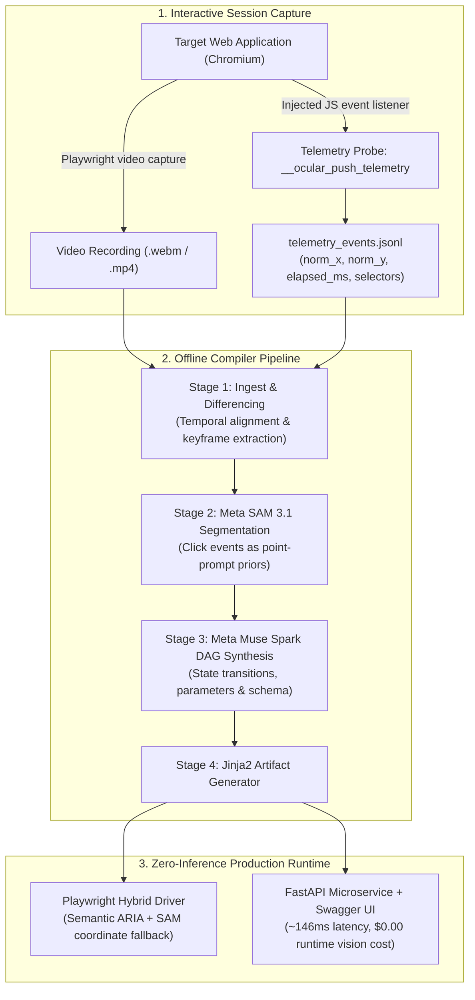

<div align="center">

```text
  ██████╗  ██████╗██╗   ██╗██╗      █████╗ ██████╗ 
 ██╔═══██╗██╔════╝██║   ██║██║     ██╔══██╗██╔══██╗
 ██║   ██║██║     ██║   ██║██║     ███████║██████╔╝
 ██║   ██║██║     ██║   ██║██║     ██╔══██║██╔══██╗
 ╚██████╔╝╚██████╗╚██████╔╝███████╗██║  ██║██║  ██║
  ╚═════╝  ╚═════╝ ╚═════╝ ╚══════╝╚═╝  ╚═╝╚═╝  ╚═╝
```

**Offline Visual Workflow Compiler**  
*Built for the Meta Global AI Developer Hackathon 2026*

[](#)
[](#)
[](#)
[](#)

</div>

## The Paradigm Shift: Ahead-of-Time Visual Compilation

Traditional Multimodal Vision Agents are fragile, slow, and expensive. Taking screenshots, transmitting base64 payloads, and waiting for LLM spatial reasoning at runtime results in 12,000ms+ latencies, stochastic hallucinations, and high API costs per action.

**Ocular** shifts foundation models to compile-time. It digests human screen recordings (MP4) and uses **Meta SAM 3.1** and **Meta Muse Spark** to synthesize a deterministic Directed Acyclic Graph (DAG). It then emits a zero-inference Playwright execution driver wrapped in a typed FastAPI microservice.

**The result: ~146ms execution latency, $0.00 runtime vision cost, and 100% deterministic reliability.**

---

## Key Architectural Innovations

### 1. Dual-Tier Hybrid Resilience
Ocular drivers do not rely blindly on absolute pixels. The compiler emits a resilient execution matrix:
* **Tier 1 (Semantic Accessibility):** Primary execution binds natively to the DOM using ARIA roles (`page.get_by_role`), making the driver immune to CSS layout refactors and responsive UI shifts.
* **Tier 2 (Meta SAM 3.1 Visual Fallback):** If an element is obfuscated by shadow DOMs, virtualized trees, or rendered inside an HTML5 `<canvas>` (e.g., WebGL charts), the driver catches the DOM exception and seamlessly translates SAM 3.1 scale-invariant coordinates into exact viewport clicks.

### 2. Dynamic Parameterization & Type Synthesis
Ocular is not a static macro recorder. During Stage 3, **Meta Muse Spark** actively infers workflow variables (like search queries or chart intervals) from the visual recording. 
* Synthesizes a strict JSON schema embedded directly in the DAG.
* Code-generates a typed `Pydantic v2` payload (`ExecutionPayload`).
* Binds it dynamically to a generated `FastAPI` route, exposing an interactive Swagger UI for the workflow automatically.

### 3. Zero-Runtime Cost (ZRC)
Because spatial segmentation and state-transition logic are computed once during compilation, the emitted microservice runs entirely offline via Playwright. Zero runtime API calls mean zero token egress and zero ongoing cost.

---

## System Architecture



---

## How It Works (The Compiler Pipeline)

1. **Stage 0: Interactive Session Recorder (`ocular record`)**
   Spawns a headed Playwright browser session with an injected client-side telemetry probe (`__ocular_push_telemetry`). Captures raw interaction video alongside a streaming `telemetry_events.jsonl` file logging normalized coordinates (`norm_x`, `norm_y`), keypresses, and timestamps.
2. **Stage 1: Video Ingest & Temporal Differencing** 
   Extracts key transition frames and user interaction coordinates from the recorded video, aligning keyframes with telemetry timestamps.
3. **Stage 2: Spatial Segmentation (`api.meta.ai`)**
   **Meta SAM 3.1** evaluates the frames using recorded click events as point-prompt priors, synthesizing scale-invariant visual masks (`[0.0, 1.0]`) for all interactive elements.
4. **Stage 3: DAG Synthesis (`inference.baseten.co`)**
   **Meta Muse Spark** evaluates state transitions, infers structural logic, extracts parameters, and compiles the verified state graph.
5. **Stage 4: Artifact Generation**
   Jinja2 templates emit the final production artifacts: `playwright_driver.py`, `app.py`, `main.py`, and typed `Pydantic` schemas.

---

## Quick Start & Verification

**Prerequisites:** Python 3.11+ and Playwright installed.

### 1. Record an Interactive Browser Session
Launch the interactive session recorder targeting any web application:
```bash
python -m ocular record --url http://localhost:3000 --out-dir ./recordings
```
*An interactive browser window opens with client-side telemetry probes injected. Interact with the target application (clicking buttons, entering inputs) and close the browser window when finished. Ocular saves the high-resolution video and `telemetry_events.jsonl` stream.*

### 2. Compile a Visual Workflow
Pass the recorded session into the Ocular compiler:
```bash
python -m ocular compile --input ./recordings/session.webm --out-dir ./dist
```
*If a `telemetry_events.jsonl` file is co-located in the input directory, Ocular automatically ingests it as point-prompt priors for SAM 3.1 and transition boundaries for Muse Spark. Alternatively, supply it explicitly with `--telemetry <path>`.*

### 3. Execute the Emitted Driver (Headless)
Run the emitted Playwright driver directly, injecting dynamic parameters on the fly:
```bash
python dist/playwright_driver.py --params '{"interval": "1h"}'
```
*The CLI will output a Rich telemetry dashboard confirming execution strategy (Semantic vs. SAM Visual), target anchor resolution, and sub-200ms latency.*

### 4. Launch the Emitted FastAPI Microservice
Start the auto-generated REST API server:
```bash
uvicorn dist.main:app --reload
```
Navigate to `http://127.0.0.1:8000/docs` to interact with the auto-generated Swagger documentation and execute your compiled visual workflow via POST request.

---

## Test Suite

Ocular includes a comprehensive pytest suite covering DAG synthesis, hybrid driver resilience, dynamic parameter injection, and fallback mechanics.

```bash
pytest
```