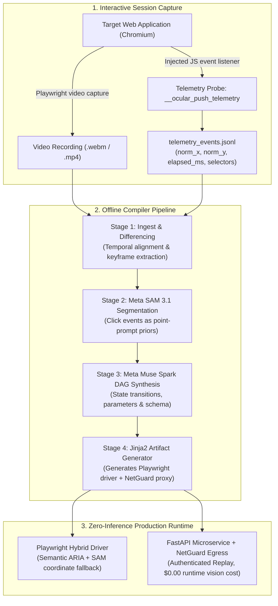

<div align="center">

```text
  ██████╗  ██████╗██╗   ██╗██╗      █████╗ ██████╗ 
 ██╔═══██╗██╔════╝██║   ██║██║     ██╔══██╗██╔══██╗
 ██║   ██║██║     ██║   ██║██║     ███████║██████╔╝
 ██║   ██║██║     ██║   ██║██║     ██╔══██║██╔══██╗
 ╚██████╔╝╚██████╗╚██████╔╝███████╗██║  ██║██║  ██║
  ╚═════╝  ╚═════╝ ╚═════╝ ╚══════╝╚═╝  ╚═╝╚═╝  ╚═╝
```

**Ahead-of-Time Visual Web Compiler**  
*Built for the Meta Global AI Developer Hackathon 2026*

[](#)
[](#)
[](#)
[](#)

</div>

## The Paradigm Shift: Ahead-of-Time Visual Compilation

Traditional Multimodal Vision Agents are fragile, slow, and expensive. Taking screenshots, transmitting base64 payloads, and waiting for LLM spatial reasoning at runtime results in high latencies, stochastic hallucinations, and continuous API costs per action.

**Ocular** shifts foundation models to compile-time. It digests human screen interactions and uses **Meta SAM 3.1** and **Meta Muse Spark** to synthesize a deterministic Directed Acyclic Graph (DAG). It then emits a zero-runtime-inference Playwright execution driver wrapped in an authenticated FastAPI microservice.

**The result: $0.00 runtime vision cost, sub-second deterministic execution, and complete isolation from runtime LLM dependencies.**

---

## Key Architectural Innovations

### 1. Dual-Tier Hybrid Resilience
Ocular drivers do not rely blindly on absolute pixels. The compiler emits a resilient execution matrix:
- **Tier 1 (Semantic Accessibility):** Primary execution binds natively to the DOM using ARIA roles (`page.get_by_role`), making the driver immune to CSS layout refactors and responsive UI shifts.
- **Tier 2 (Meta SAM 3.1 Visual Fallback):** If an element is obfuscated by shadow DOMs, virtualized trees, or rendered inside an HTML5 `<canvas>` (e.g., WebGL charts), the driver catches the DOM exception and seamlessly translates SAM 3.1 scale-invariant coordinates into exact viewport clicks.

### 2. In-Process Egress Confinement (`netguard.py`)
Autonomous tools risk data exfiltration and Server-Side Request Forgery (SSRF). Ocular automatically wraps emitted Playwright browser contexts in an in-process proxy firewall (`netguard.py`) that strictly enforces allowed domains, isolates metadata, and prevents unauthorized route traversal.

### 3. Dynamic Parameterization & Sensitive Data Redaction
- Synthesizes a strict JSON schema embedded directly in the DAG.
- Code-generates a typed `Pydantic v2` payload (`ExecutionPayload`).
- Masks sensitive parameter values (`password`, `token`, `secret`, `key`) with `[REDACTED]` across execution logs and trace exceptions.
- Binds routes dynamically to FastAPI, exposing interactive schema documentation for authenticated workflow triggers.

### 4. Zero-Runtime Cost (ZRC)
Because spatial segmentation and state-transition logic are computed once during compilation, the emitted microservice runs entirely offline via Playwright. Zero runtime model inference means zero token egress and zero ongoing cost.

---

## System Architecture



---

## How It Works (The Compiler Pipeline)

1. **Stage 0: Interactive Session Recorder (`ocular record`)**
   Spawns a headed Playwright browser session with an injected client-side telemetry probe (`__ocular_push_telemetry`). Captures raw interaction video alongside a streaming `telemetry_events.jsonl` file logging normalized coordinates (`norm_x`, `norm_y`), keypresses, and timestamps.
2. **Stage 1: Video Ingest & Temporal Differencing** 
   Extracts key transition frames and user interaction coordinates from the recorded video, aligning keyframes with telemetry timestamps.
3. **Stage 2: Spatial Segmentation (`api.meta.ai`)**
   **Meta SAM 3.1** evaluates the frames using recorded click events as point-prompt priors, synthesizing scale-invariant visual masks (`[0.0, 1.0]`) for all interactive elements.
4. **Stage 3: DAG Synthesis (`inference.baseten.co`)**
   **Meta Muse Spark** evaluates state transitions, infers structural logic, extracts parameters, and compiles the verified state graph.
5. **Stage 4: Hardened Artifact Generation**
   Jinja2 templates emit the production artifacts: `playwright_driver.py`, `app.py`, `netguard.py`, `workflow.json`, and typed schemas.

---

## Verified Driver Execution Telemetry

```text
================================================================================
                         Ocular Driver Execution Telemetry                      
================================================================================
  Telemetry Metric       │ Value / Status                                       
─────────────────────────┼──────────────────────────────────────────────────────
  Workflow Class         │ TradingviewWorkflow                                  
  Execution Strategy     │ Semantic Accessibility (Roles / Locators)            
  Browser Mode           │ Visible (Headed)                                     
  Target Anchor          │ div.js-button-text_text-zm3YRUFG                     
  Steps Executed         │ 2                                                    
  Runtime Inference Cost │ $0.00 (Zero Runtime Vision)                          
  Compile Hash           │ 81d99c65bf6691b1                                     
  Landed URL             │ [https://www.tradingview.com/chart/](https://www.tradingview.com/chart/)                   
  Execution Status       │ ✓ PASSED                                             
================================================================================
```

---

## Quick Start & Verification

**Prerequisites:** Python 3.11+ and Playwright installed.

### 1. Setup Environment
```bash
git clone [https://github.com/japanchicken898-droid/Ocular.git](https://github.com/japanchicken898-droid/Ocular.git)
cd Ocular
python3 -m venv .venv
source .venv/bin/activate
pip install -e .
playwright install chromium
```

### 2. Execute Pre-Compiled Workflow (Headed)
Run the emitted Playwright driver directly against TradingView:
```bash
python dist_tradingview/playwright_driver.py --headed
```
*The driver executes the compiled interaction, verifies postconditions, and outputs the telemetry card confirming `$0.00` runtime inference cost.*

### 3. Launch the Emitted FastAPI Microservice
Start the auto-generated, egress-guarded REST API server:
```bash
export OCULAR_ENABLE_DOCS=1
export OCULAR_API_KEY="ocular-demo-key-2026"
uvicorn dist_tradingview.app:app --port 8000
```


---

## Recording & Compiling New Workflows

### 1. Record an Interactive Browser Session
Launch the interactive session recorder targeting any web application:
```bash
ocular record --url "The website url"
```
*An interactive browser window opens with client-side telemetry probes injected. Interact with the target application and close the browser window when finished. Ocular saves the high-resolution video and telemetry stream to `./recordings`.*

### 2. Compile a Visual Workflow
Pass the recorded session into the Ocular compiler using Meta's vision stack:
```bash
export OCULAR_ALLOW_EXTERNAL_INFERENCE=1
ocular compile -i recordings/ --output dist_tradingview
```
*Meta SAM 3.1 resolves spatial segmentation across canvas and non-DOM boundaries, and Meta Muse Spark compiles verified state transitions into `dist_tradingview/`.*

---

## Confinement & Test Suite

Ocular includes a 145-test confinement suite covering DAG synthesis, hybrid driver resilience, dynamic parameter injection, SSRF egress filtering, and secret redaction.

```bash
pytest
```